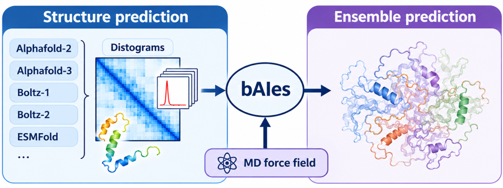

# bAIes-IDP-OpenMM

<p align="center">
  
</p>

OpenMM implementation of bAIes

Please cite the following references when using this tool:

- V. Schnapka, T. Morozova, S. Sen, M. Bonomi. Atomic resolution ensembles of intrinsically disordered with Alphafold. Nature Communications (2026). doi: [https://doi.org/10.1038/s41467-026-69172-y](https://doi.org/10.1038/s41467-026-69172-y)

- V. Schnapka, N. Portal, M. Bonomi. Leveraging state-of-the-art AI structure predictors to generate atomic resolution ensembles of intrinsically disordered proteins. BioRxiv (2026). doi: []()


## Installation instructions

To run bAIes with OpenMM, you just need a python environment with OpenMM installed.

### 1. Create a new environment

for example with conda:

```bash
conda create -n baies python=3.13
conda activate baies
```

### 2. Install OpenMM and dependencies

```bash
conda install -c conda-forge openmm=8.3 cuda-version=13
```

The `cuda-version` pin selects the CUDA build of OpenMM. Set it to a CUDA version that is supported by both your GPU driver and your OpenMM release (check with `nvidia-smi`). On a machine without a GPU, omit it to get the CPU build.

To check that OpenMM sees your hardware:

```bash
python -m openmm.testInstallation
```

### 3. Run bAIes.
