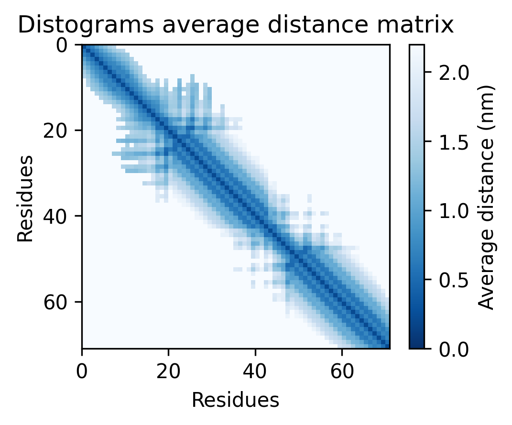
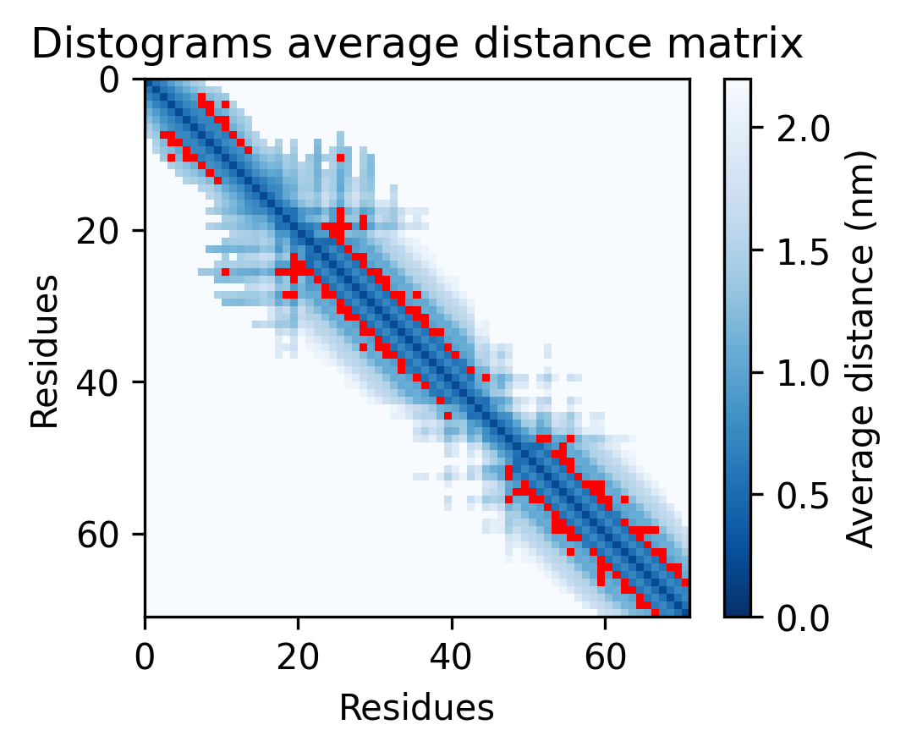

# bAIes-IDP-OpenMM

You can run bAIes with openMM in this directory.

You will find here the following directories:
* `scripts`, which contains the necessary python scripts to run bAIes
* `predictions`, the directory where you can add your predictions (model (.pdb) and distograms (.pkl)). You will find an example subdirectory with a predicted model of PaaA2.
* `force_field`, which contains the coil prior force field.
* `bAIes_simulation`, which contains an example output for the preparation of a bAIes simulation of PaaA2.

## Quickstart

### 0. Run a structure prediction

You can use AlphaFold2, AlphaFold3, Boltz-1, Boltz-2, ESMFold or ESMFold2.

Collect a predicted model (.pdb) and the distograms (.pkl) and deposit them in a subdirectory in the `predictions` directory.

If the predicted model is in mmCIF format (.cif), you can convert it to PDB by running the following on the terminal. Make sure to replace the elements in <> brackets by the desired file paths.

```bash
scripts/cif2pdb.py <path_to_cif_file>.cif <path_to_output_file>.pdb
```

Ensure that your structure predictor outputs the distograms [here](link)

### 1. Prepare the inputs

Run on the terminal:

```bash
./1-prepare_bAIes.bash -pdb <path_to_prediction_pdb>.pdb \
                       -pkl <path_to_distograms>.pkl \
                       -out <output_directory>
```

This command will read the pdb model, protonate it if necessary and deposit the protonated version in the <output_directory> under the same name. It will also read the distograms, analyze them and output the bAIes input file in the <output_directory>.

### 2. Run bAIes.

Run the following on the terminal to start a bAIes simulation.:

```bash
./2-run_bAIes.bash -pdb <path_to_bAIes_pdb>.pdb \
                   -baies <path_to_baies_params>.dat \
                   -out <output_directory>
```

To modify the simulation time and frame save interval, go inside the script and modify the associated lines:

```
# Target number of frames:
Nsteps=50000000
# Simulation timestep in fs
tstep=0.002
# Save interval in number of steps.
save_interval=50000
```

Here, we are running 0.002fs*50,000,000=100ns of simulations where we save frames every 0.002fs*50,000=100ps. We do not recommend the change of the simulation time step.

### 2.bis Run coil.

You can run a `coil` simulation by simply omitting the -baies argument.

```bash
./2-run_bAIes.bash -pdb <path_to_bAIes_pdb>.pdb \
                   -out <output_directory>
```

### 2.ter Run bAIes-N

You can run a "more confident" bAIes prediction with bAIes-N. The bAIes forces will be stronger but less forgiving in case of prediction errors.
To do so, go inside `2-run_bAIes.bash` and modify the command that launches bAIes to add the `-prior 'none'` flag. This will deactivate the error marginalization and effectively run bAIes-N instead of bAIes. The command will then look like this:

```
echo "Running bAIes-N..."
python ./scripts/baies_openMM.py \
                  -pdb ${PDB} \
                  -xtc ${OUT}/bAIes_trajectory.xtc \
                  -ff ./force_field/coil_202602.xml \
                  -cmap ./force_field/cmap_20240524.cmap \
                  -temp 298.15 \
                  -friction 0.01 \
                  -tstep 0.002 \
                  -Nsteps ${Nsteps} \
                  -save_xtc ${save_interval} \
                  -save_stdout ${save_interval} \
                  -baies ${BAIES} \
                  -prior 'none'
```

## Example

To run a bAIes simulation of PaaA2, deposit the predicted PDB model (PaaA2.pdb) and associated distograms (PaaA2.pkl) in Predictions/PaaA2. Then run the following to prepare the inputs:

```bash
./1-prepare_bAIes.bash -pdb predictions/PaaA2/PaaA2.pdb \
                       -pkl predictions/PaaA2/PaaA2.pkl \
                       -out bAIes_simulations/PaaA2
```

Finally, after checking the simulation parameters, run the following:

```bash
./2-run_bAIes.bash -pdb bAIes_simulations/PaaA2/PaaA2.pdb \
                   -baies bAIes_simulations/PaaA2/bAIes_params.dat \
                   -out bAIes_simulations/PaaA2
```

## Tuning the simulation parameters

`2-run_bAIes.bash` calls the `bAIes_openMM.py` script in the `scripts` directory. You can directly tune the wanted number of steps, simulation time step and frame saving interval in `2-run_bAIes.bash`. You can also directly personalize bAIes_openMM.py with your desired features.

## Inspecting the distograms

You can inspect the distograms with `inspect_distograms.py`. This script will calculate the pairwise average distance and plot the average distance matrix. You can use it on a prediction as follows:

```bash
python ./inspect_distograms.py -pkl predictions/PaaA2/PaaA2.pkl \
                               -plot distograms_ave_matrix.pdf \
                               -out distograms_ave_matrix.npy
```

<p align="center">
  
</p>

If you also have the bAIes parameter file, you can include them along with the protein model to visualize the pairwise bAIes forces:

```bash
python ./inspect_distograms.py -pkl predictions/PaaA2/PaaA2.pkl \
                               -plot distograms_ave_matrix.pdf \
                               -out distograms_ave_matrix.npy \
                               -baies bAIes_simulations/PaaA2/bAIes_params.dat \
                               -pdb bAIes_simulations/PaaA2/PaaA2.pdb
```

<p align="center">
  
</p>


